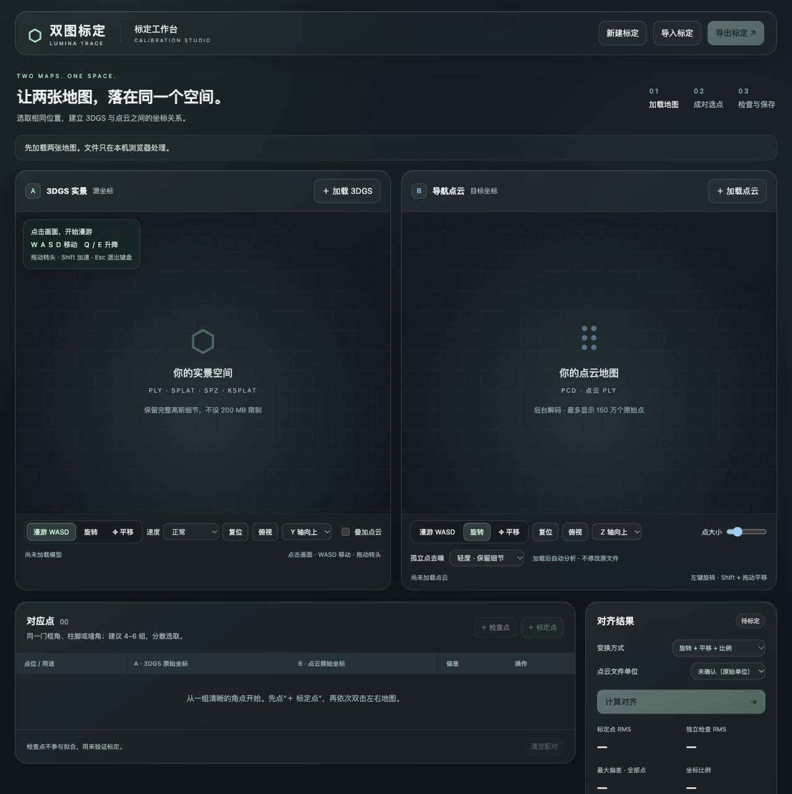

# 双图标定 · Lumina Trace

独立的 3DGS 与点云地图标定工具。在两张分别重建的地图中选择相同固定位置，求出旋转、平移与统一比例，检查误差并导出坐标变换。

本仓库只维护标定工具。地图由用户从本机导入，浏览器本地处理，不上传文件；仓库不包含任何 3D 模型或点云，也不自动加载、下载示例地图。

## 界面预览



截图为未加载地图的初始界面。

## 运行

需要 Node.js 22.12 或更新版本。

```sh
npm ci
npm run build
npm run dev
```

打开 <http://127.0.0.1:5273/> 即进入标定工作台。旧地址 `/calibration.html` 自动跳转首页。开发服务监听 `0.0.0.0:5273`，局域网内可通过运行电脑的 IP 访问。构建后的 `dist/` 可由静态 HTTP 服务提供，不要通过 `file://` 打开。

## 标定流程

1. 左侧导入 3DGS：PLY（包含高斯属性）、SPLAT、SPZ 或 KSPLAT。
2. 右侧导入导航点云：PCD 或普通点云 PLY。PCD 支持 ASCII、binary、binary_compressed。
3. 在两张地图中选取同一门框角、柱脚、墙角等固定位置。点击「＋ 标定点」，再依次双击两侧表面；也可在「编辑」中输入原始 XYZ。
4. 至少选 3 组不共线点，建议选 4–6 组、分散分布。选择旋转 + 平移，或加入统一比例校正，并确认点云文件单位。
5. 点击「计算对齐」，用左侧「叠加点云」检查重合，再添加不参与拟合的独立检查点验证。
6. 导出 JSON 保存对应点、文件关联信息、正逆变换矩阵及误差报告。支持导入恢复和本机草稿。

标定点 RMS、独立检查 RMS、最大偏差和比例都会显示，但不会自动判定现场精度合格。未确认文件单位时仅显示原始单位。没有独立检查点的结果不代表已验证准确。

## 浏览与选点

- 左侧默认自由漫游，两侧均支持漫游 / 旋转 / 平移。点击画面激活键盘，WASD 沿视线前后和横移，Q 下降 / E 上升，Shift 加速；按住左键拖动转头。Esc 或失焦停止移动。速度可选慢速、正常、快速。
- 保留复位、俯视及坐标朝向调整。轴朝向只影响显示，不修改原始坐标和标定结果。
- 点云默认轻度孤立点去噪，可改为标准、较强或关闭。Worker 计算邻点支持度；显示与拾取使用同一过滤结果，原始点坐标保持不变。
- 稀疏的有效结构可能被过滤，可降低强度。密集漂浮簇不能保证被清除。已记录的标定点不会随过滤强度自动删除或移动。
- 点云拾取优先选择点击范围内的前方表面，再取该表面层中最接近鼠标的真实顶点，减少误选背景点。

## 数据约定与限制

- 坐标保存为文件原始坐标。矩阵为行优先 4×4，方向 A → B：`p_target = scale * R * p_source + t`，同时导出逆矩阵。
- 已有 JSON 的 `spatial-ops-calibration` schema 和本机草稿键保持兼容。导入记录需要重新加载匹配模型并重新计算，不直接采信导入的矩阵。
- 文件关联使用首尾 64 KiB 与大小的快速指纹，不是完整文件完整性证明；严谨版本管理应另存完整文件校验值。
- 3DGS 按 4 MiB 分块输入，不设 200 MB 上限。点云在 Worker 完整解码，最多保留 150 万个原始点预览，叠加最多 10 万点。完整解码仍消耗内存 / 显存，抽样可能遗漏细小特征。
- 不执行 ICP 自动配准，不把 3DGS 高斯中心当作测量级表面，不修改原始地图，不连接或控制机器人。

## 开发与验证

```sh
npm run check
npm test
npm run build
```

19 项自动测试覆盖坐标变换、退化点、独立检查点、文件解析、分块读取、原始坐标保留、去噪、过滤后的射线拾取和前后表面选择。

```text
dist/index.html              标定工作台入口
dist/calibration.js          配对、草稿、导入导出及计算流程
dist/calibration-viewer.js   双视窗、模型加载、选点和叠加
dist/calibration-flight.js   WASD 自由漫游
dist/calibration-math.js     坐标变换求解与结果校验
dist/cloud-filter.js         孤立点过滤及表面优先选点
dist/model-input.js          3DGS 文件验证与分块输入
scripts/cloud-worker.mjs    点云后台解码与去噪分析
scripts/build.mjs           生成浏览器引擎和 Worker
tests/                      自动测试
```

Three.js 和 Spark 依赖版本由 `package-lock.json` 固定，构建产物 `dist/vendor/` 不纳入 Git。模型、采集文件、依赖目录和本地测试素材由 `.gitignore` 排除。
